

<a href="https://trigon.technology"></a>

 


  


  


 

<b>XERAFANG.SOLUTIONS</b> &nbsp;·&nbsp; free software with fangs  
<a href="https://github.com/XeraFang-Solutions/VRift">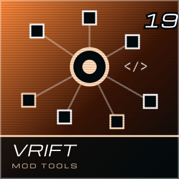</a>
<a href="https://github.com/XeraFang-Solutions/TF2-HUD-Studio"></a>
<a href="https://github.com/XeraFang-Solutions/music-framework">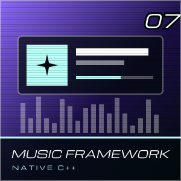</a>
<a href="https://github.com/XeraFang-Solutions/DiscordRPC-NoCRT">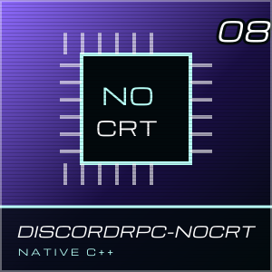</a>

<b>NIHONFEMSTYLE</b> &nbsp;·&nbsp; personal systems  
<a href="https://github.com/NihonFemStyle/Universal-DllMain">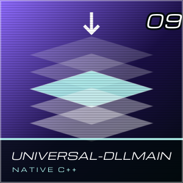</a>
<a href="https://github.com/NihonFemStyle/hyprupld">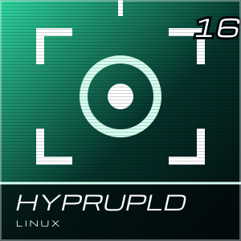</a>
<a href="https://github.com/NihonFemStyle/AppImage-Installer"></a>
<a href="https://github.com/NihonFemStyle/bash2appimage"></a>
<a href="https://github.com/NihonFemStyle/Bartender">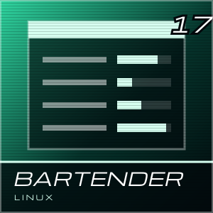</a>

<b>ACROSS THE NETWORK</b> &nbsp;·&nbsp; lunaris · redline  
<a href="https://github.com/Lunaris-Surf/TF2PL">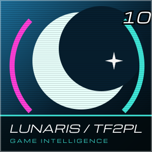</a>
<a href="https://github.com/Redline-Team/RPM">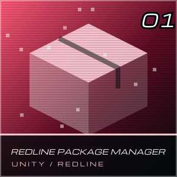</a>

<b>READ THE BRIEFS ▸</b>

 

| System | Brief | Stack |
|:--|:--|:--|
| [**VRift**](https://github.com/XeraFang-Solutions/VRift) | Visual studio for Hacknet extensions: project-wide validation, safe renames, hot reload into the running game | TypeScript |
| [**TF2 HUD Studio**](https://github.com/XeraFang-Solutions/TF2-HUD-Studio) | Cross-platform visual studio for building Team Fortress 2 HUDs | TypeScript · Rust |
| [**Music Framework**](https://github.com/XeraFang-Solutions/music-framework) | Offline, open-source now-playing overlay | C++ · CMake · NoCRT |
| [**DiscordRPC-NoCRT**](https://github.com/XeraFang-Solutions/DiscordRPC-NoCRT) | Discord Rich Presence with no C runtime: raw IPC, tiny binaries | C++ |
| [**Universal-DllMain**](https://github.com/NihonFemStyle/Universal-DllMain) | A DllMain built while testing injection methods, made to cover most cases | C |
| [**hyprupld**](https://github.com/NihonFemStyle/hyprupld) | All-in-one screenshot and upload tool for Linux and macOS | Shell |
| [**AppImage-Installer**](https://github.com/NihonFemStyle/AppImage-Installer) | Installs AppImages system-wide with command aliasing | Bash |
| [**bash2appimage**](https://github.com/NihonFemStyle/bash2appimage) | Compiles Bash scripts into AppImages | Bash |
| [**Bartender**](https://github.com/NihonFemStyle/Bartender) | A manager for Sober | Python |
| [**TF2PL**](https://github.com/Lunaris-Surf/TF2PL) | Player intelligence for TF2 with an expanded feature set | C++ |
| [**RPM**](https://github.com/Redline-Team/RPM) | An in-engine alternative to the VRChat Creator Companion and ALCOM | C# · Unity |

 


  

<table>
  <tr>
    <td align="center" width="20%"><a href="https://github.com/XeraFang-Solutions"> <b>XeraFang</b></a> lead · FOSS group</td>
    <td align="center" width="20%"><a href="https://github.com/TrigonSystems"> <b>Trigon</b></a> the core</td>
    <td align="center" width="20%"><a href="https://github.com/Lunaris-Surf"> <b>Lunaris</b></a> TF2 intelligence</td>
    <td align="center" width="20%"><a href="https://github.com/Redline-Team"> <b>Redline</b></a> VRChat tooling</td>
    <td align="center" width="20%"><a href="https://github.com/Nemesis-Surf"> <b>Nemesis</b></a> archived → XeraFang</td>
  </tr>
</table>

<a href="https://trigon.technology">trigon.technology</a> &nbsp;·&nbsp;
<a href="https://xerafang.solutions">xerafang.solutions</a> &nbsp;·&nbsp;
<a href="https://vrift.xerafang.solutions">vrift</a> &nbsp;·&nbsp;
<a href="https://music.xerafang.solutions">music</a> &nbsp;·&nbsp;
<a href="https://trigon.systems">trigon.systems</a> &nbsp;·&nbsp;
<a href="https://arch-linux.pro">arch-linux.pro</a> &nbsp;·&nbsp;
<a href="https://lunaris.surf">lunaris.surf</a>

  

 


  

 


  

  

  

